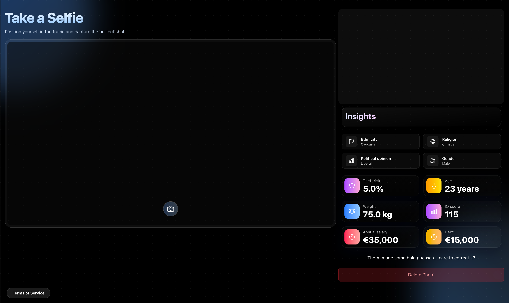

# ParallaxAI



An AI photo booth about how much AI makes up. You step into the booth, it takes your picture, and an AI model guesses
things about you from your face alone: age, height, weight, salary, IQ, political opinion, religion and more. The
guesses are confident and unfounded, which is the point: the project wants people to think twice before trusting
what an AI says about a person. Afterwards a QR code leads to a short form about how the results felt. A Dark Tech
project at the HvA (semester 1, 2025–2026), comparing Claude, Gemini and GPT models.

## Stack

| | |
|---|---|
| Frontend | Vue 3, TypeScript, Vue Router, Tailwind CSS 4, Vite |
| Face detection | TensorFlow.js with BlazeFace, in the browser |
| Charts | Chart.js, on the dashboard |
| QR codes | `qrcode.vue`, linking the booth to the form |
| Backend | FastAPI on Uvicorn, Python |
| AI | Anthropic, Google Gemini and OpenAI SDKs |
| Data | MariaDB; JWT (`python-jose`) and bcrypt for sign-in and form links |
| Hosting | Docker Compose: backend on port 8000, frontend on 3000 |

## Getting started

```bash
cd backend
pip install -r requirements.txt
uvicorn main:app --reload        # http://localhost:8000
```

```bash
cd frontend
npm install
npm run dev
```

The backend reads `GEMINI_API_KEY`, `CLAUDE_API_KEY`, `OPENAI_API_KEY` and the `DB_*` settings from a `.env` file in
`backend/`. The full guide is in [docs/installation.md](docs/installation.md). `docker-compose.yml` has a production and
a development pair of containers.

## Pages

| Route | |
|---|---|
| `/` | The selfie camera with face detection, and the assumptions next to your photo |
| `/booth` | The version for the physical booth, with the QR code to the form |
| `/form` | The follow-up questions, opened with a token so nobody can fill in someone else's |
| `/login`, `/dashboard` | Sign-in for the team, and charts of the assumptions the models made |
| `/terms-of-service` | Terms of service |

## Documentation

- [Frontend](docs/frontend/index.md): the Vue application
- [AI models](docs/ai/index.md): integration, return format and the model comparison
- [Database ERD](docs/database/database_erd.md)
- [Form](docs/form/index.md) and [login and JWT](docs/login%20and%20jwt/)
- [The booth](docs/booth/index.md): sketches and dimensions of the physical booth
- [Society 5.0](docs/society%205/index.md): research and analysis
- [Advice report](docs/adviesrapport.md) and the sprint reviews in `docs/sprint 1` to `docs/sprint 4`

## Project structure

| Path | |
|---|---|
| `frontend/src/pages/` | Selfie camera, photo booth, form, login, dashboard and terms |
| `frontend/src/components/` | Assumption panels, form questions, upload and terms |
| `frontend/src/composables/useFaceDetection.ts` | BlazeFace in the browser |
| `frontend/src/services/` | API calls, webcam, cookies and the upload store |
| `backend/main.py` | FastAPI app and its routers |
| `backend/controllers/`, `backend/services/` | Assumptions, auth, form, database and status |
| `backend/clients/` | Claude, Gemini and OpenAI clients |
| `backend/constants/prompt.py` | The prompt every model gets |
| `backend/db/create_tables.sql` | Database schema |
| `docs/` | Documentation, research and sprint reviews |
